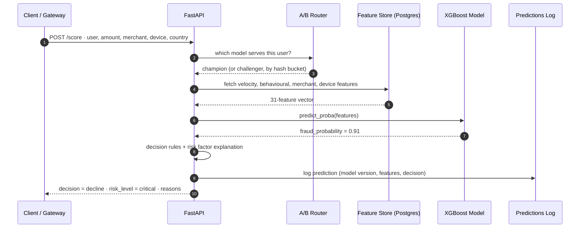
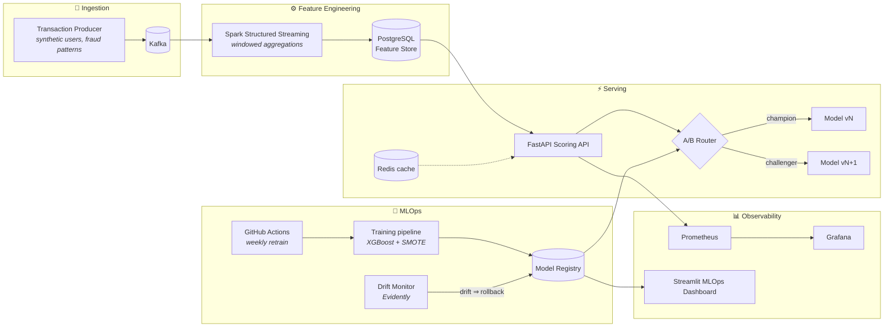
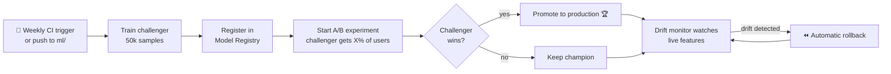

<div align="center">

# 🛡️ Fraud Guard

### Real-time payment fraud detection, built like a production ML platform

*Every transaction gets a verdict, an explanation, and an audit trail in about 110 ms.*


[How it works](#-how-a-transaction-is-judged) •
[Architecture](#-architecture) •
[Quick start](#-quick-start) •
[API](#-api-reference) •
[MLOps](#-the-mlops-loop) •
[Performance](#-performance) •
[Deploy](#-deploying-to-kubernetes)

</div>

---

## 💡 The idea

A card is swiped. Fraud Guard has a fraction of a second to decide whether it was the card's owner.

To make that call, the system combines what it knows about **the user** (how much they usually spend and where), **the device** (whether it's been seen before), **the merchant** (how often it sees fraud) and **the moment** (2 a.m. in a new country?). It condenses all of this into 31 features, runs an XGBoost model and returns one of three decisions: **approve**, **review** or **decline**, along with the reasons.

Around that model is everything a real ML system needs: streaming feature engineering, a feature store, a model registry, champion/challenger A/B testing, drift detection with automatic rollback, metrics, dashboards, load tests and a Kubernetes deployment.

## ✨ Highlights

| | |
|---|---|
| ⚡ **Real-time scoring** | FastAPI service with single and batch scoring, ~110 ms median latency under sustained load |
| 🌊 **Streaming features** | Spark Structured Streaming turns the Kafka stream into windowed velocity, merchant and behavioural features |
| 🗄️ **Feature store** | PostgreSQL-backed online store with a freshness API, so you know when features go stale |
| 📚 **Model registry** | Versioned models with `staging → challenger → production` stages, promotion and one-call rollback |
| 🧪 **A/B testing** | Deterministic champion/challenger routing: each user is hashed into a stable bucket |
| 📉 **Drift detection** | Evidently compares live feature distributions to the training data and rolls back on drift |
| 🔍 **Explainable decisions** | Each score includes human-readable reasons such as *"Transaction from new device"* or *"CVV verification failed"* |
| 📊 **Observability** | Prometheus metrics, Grafana dashboards and a Streamlit MLOps console |
| 🤖 **Automated retraining** | A weekly GitHub Actions job trains a challenger and starts an A/B experiment |
| ☸️ **Cloud-ready** | Helm chart for GKE/EKS with HPA autoscaling (2–5 pods), ingress and TLS |

---

## 🔎 How a transaction is judged



### The decision ladder

| Fraud probability | Decision | Risk level | What happens |
|---|---|---|---|
| `≥ 0.80` | 🔴 **decline** | critical | Blocked automatically, alert raised |
| `0.50 – 0.79` | 🟠 **review** | high | Sent to a human analyst |
| `0.20 – 0.49` | 🟡 **approve** | medium | Approved and watched |
| `< 0.20` | 🟢 **approve** | low | Approved |

### What the model looks at (31 features)

| Family | Examples |
|---|---|
| **Velocity (1 h)** | transaction count, total / average / max / std-dev amount |
| **Behaviour (30 d)** | average spend, unique merchants, countries and devices, account age, verified status, past fraud, user risk score |
| **Merchant (24 h)** | transaction volume, average ticket, fraud rate |
| **Device** | lifetime transactions, fraud rate, high-risk flag |
| **This transaction** | amount, deviation from the user's average, new country / device / merchant, CVV match, billing ZIP match |
| **Time** | hour of day, day of week, weekend, night-time |

---

## 🏗️ Architecture



For a deeper walkthrough of every component, see **[ARCHITECTURE.md](ARCHITECTURE.md)**.

### Tech stack

| Layer | Technology |
|---|---|
| Streaming | Apache Kafka (Confluent 7.5), Kafka UI |
| Stream processing | Apache Spark 3.5 Structured Streaming |
| Storage | PostgreSQL 15 (feature store, registry, predictions), Redis 7 |
| Machine learning | XGBoost, scikit-learn, imbalanced-learn (SMOTE), Evidently |
| Serving | FastAPI, Uvicorn, Pydantic v2 |
| Observability | Prometheus, Grafana, Streamlit |
| Testing | Pytest, Locust |
| Infrastructure | Docker Compose, Helm / Kubernetes, GitHub Actions, AWS scripts |

---

## 🚀 Quick start

### Prerequisites

- Docker and Docker Compose
- Python 3.11+

### 1. Start the infrastructure

```bash
git clone https://github.com/CapCoder0/Fraud-Guard.git
cd Fraud-Guard

docker compose up -d
```

### 2. Create the schema

```bash
docker exec -i postgres-fraud-db psql -U frauduser -d fraud_detection < feature_store/schema.sql
```

### 3. Train and register a model

```bash
python -m venv venv && source venv/bin/activate
pip install -r requirements.txt

export DB_HOST=localhost DB_PORT=5433 DB_NAME=fraud_detection \
       DB_USER=frauduser DB_PASSWORD=fraudpass123

python -m ml.train_model --samples 50000 --stage production
```

### 4. Start the API

```bash
python -m uvicorn api.main:app --host 0.0.0.0 --port 8000 --reload
```

Open **http://localhost:8000/docs** for interactive Swagger docs.

> 💡 You can also run `./run.sh`, which checks Docker, sets up the virtualenv, starts the services, trains a model and launches the API in one go.

### 5. Stream some transactions (optional)

```bash
python streaming/kafka_producer.py         # synthetic normal + fraudulent traffic
python streaming/transaction_processor.py  # Spark feature engineering
```

### 🧭 Where everything lives

| Service | URL | Notes |
|---|---|---|
| Fraud Scoring API | http://localhost:8000/docs | Swagger UI |
| MLOps Dashboard | http://localhost:8502 | Registry, A/B tests, drift |
| Grafana | http://localhost:3000 | admin / admin |
| Prometheus | http://localhost:9090 | |
| Kafka UI | http://localhost:8080 | |
| Spark UI | http://localhost:8081 | |
| PostgreSQL | `localhost:5433` | `frauduser` / `fraud_detection` |

> ⚠️ The credentials above are local demo defaults. Change them before deploying anywhere public.

---

## 📡 API reference

### Score a transaction

```bash
curl -X POST http://localhost:8000/score \
  -H "Content-Type: application/json" \
  -d '{
        "user_id": "user-42",
        "amount": 4999.00,
        "currency": "USD",
        "merchant_id": "merch-777",
        "merchant_category": "electronics",
        "country": "SG",
        "device_id": "dev-new-01",
        "cvv_match": false,
        "billing_zip_match": false
      }'
```

```json
{
  "transaction_id": "txn_...",
  "fraud_score": 0.93,
  "decision": "decline",
  "risk_level": "critical",
  "model_version": "v3",
  "model_role": "champion",
  "reasons": [
    "Transaction amount significantly above user average",
    "Transaction from new country",
    "Transaction from new device",
    "CVV verification failed",
    "Billing ZIP code mismatch"
  ],
  "processing_time_ms": 41,
  "feature_retrieval_time_ms": 33,
  "model_inference_time_ms": 4
}
```

<sub>Illustrative response. Scores and timings depend on your trained model and data.</sub>

### All endpoints

| Method | Endpoint | Purpose |
|---|---|---|
| `GET` | `/` | Service info |
| `GET` | `/health` | Health check and whether a model is loaded |
| `POST` | `/score` | Score one transaction |
| `POST` | `/score/batch` | Score many transactions |
| `GET` | `/metrics` | Model and decision metrics |
| `GET` | `/features/{user_id}` | Inspect a user's current features |
| `POST` | `/model/reload` | Hot-reload models from the registry |
| `GET` | `/registry/models` | List every registered model version |
| `POST` | `/registry/promote` | Promote a version to a stage |
| `GET` | `/ab/experiment` | Show the running A/B experiment |
| `POST` | `/ab/experiment` | Start an experiment (`traffic_pct` to challenger) |
| `DELETE` | `/ab/experiment` | Stop the experiment |
| `GET` | `/drift/status` | Latest drift report |
| `GET` | `/feature-store/freshness` | How recently each feature table was updated |

---

## 🔁 The MLOps loop



- **Registry.** `ml/registry.py` stores every model version in Postgres with metrics, training size, fraud rate and a pointer to its reference data. Promoting a version demotes whatever held that stage before.
- **A/B router.** `ml/ab_router.py` hashes each `user_id` (MD5) into a stable bucket in `[0, 1)`. A user always sees the same model during an experiment, so results aren't skewed by users bouncing between models.
- **Drift monitor.** `ml/drift_monitor.py` runs Evidently's `DataDriftPreset` against the production model's reference data, writes results to `drift_reports`, and rolls back if drift crosses the threshold. Run `python -m ml.drift_monitor --simulate-drift` to watch a rollback happen.
- **CI.** `.github/workflows/mlops.yml` starts a Postgres service, trains a challenger and starts an A/B experiment every Sunday at midnight, on pushes to `ml/` or `feature_store/`, or on demand.

### Training details

- **Algorithm:** XGBoost (`max_depth=6`, `n_estimators=200`)
- **Imbalance handling:** SMOTE oversampling (fraud up to 50% of the majority class) followed by random undersampling
- **Data:** synthetic transactions with realistic fraud patterns (new devices, foreign countries, spending spikes, card-testing bursts), with a 2% default fraud rate

---

## 📈 Performance

Measured with Locust: **80 concurrent users for 10 minutes** against **4 Uvicorn workers**, all on one laptop. Raw results are committed in [`load_test/`](load_test/).

| Metric | `/score` |
|---|---|
| Requests served | **166,199** |
| Failures | **0** |
| Throughput | **~277 req/s** |
| Median latency | **110 ms** |
| p95 latency | 280 ms |
| p99 latency | 360 ms |

> The bottleneck is Postgres feature reads, not the model. Adding workers helps more than speeding up inference. See [load_test/README.md](load_test/README.md) for the full method and caveats.

Run it yourself:

```bash
locust -f load_test/locustfile.py --host http://127.0.0.1:8100 \
       --users 80 --spawn-rate 20 --run-time 10m --headless --csv load_test/results
```

---

## ☸️ Deploying to Kubernetes

The Helm chart in [`helm/fraud-guard`](helm/) deploys the whole stack (API, Postgres, Kafka in KRaft mode, Spark, Prometheus and Grafana) to GKE or EKS.

```bash
helm install fraud-guard ./helm/fraud-guard \
  --set postgres.auth.password=YOUR_SECURE_PASSWORD \
  --set grafana.auth.adminPassword=YOUR_GRAFANA_PASSWORD
```

- The API autoscales between **2 and 5 pods** using a HorizontalPodAutoscaler
- nginx ingress with TLS through cert-manager
- Secrets are injected from a Kubernetes `Secret`, not stored in images

Full guide: **[helm/README.md](helm/README.md)**. For a simpler single-VM setup, see `scripts/deploy_aws.sh` (AWS free tier).

---

## 📁 Project structure

```
Fraud-Guard/
├── api/                  # FastAPI app + scoring engine
│   ├── main.py
│   └── fraud_scorer.py
├── streaming/            # Kafka producer + Spark feature processor
├── feature_store/        # Postgres schema + online feature retrieval
├── ml/                   # Training, registry, A/B router, drift monitor
├── dashboard/            # Streamlit MLOps console
├── monitoring/           # Prometheus config + Grafana dashboards
├── helm/                 # Kubernetes Helm chart
├── load_test/            # Locust scenario + committed results
├── tests/                # API tests (pytest)
├── scripts/              # DB init, service control, AWS deploy
├── .github/workflows/    # Weekly MLOps retraining pipeline
├── docker-compose.yml
└── ARCHITECTURE.md
```

## 🧪 Tests

```bash
pytest tests/ -v
```

---

## 🗺️ Roadmap

- [ ] Online learning from analyst review labels
- [ ] SHAP explanations in place of rule-based risk factors
- [ ] Graph features (shared devices and cards across users)
- [ ] Redis-first feature cache to cut p99 latency
- [ ] Persistent A/B results with statistical significance testing

## ⚠️ Disclaimer

Fraud Guard is trained on **synthetic data**. It demonstrates architecture and MLOps practices and has not been validated against real-world fraud.

<div align="center">

**Built with ☕ and a healthy distrust of 3 a.m. transactions from new devices.**

</div>
